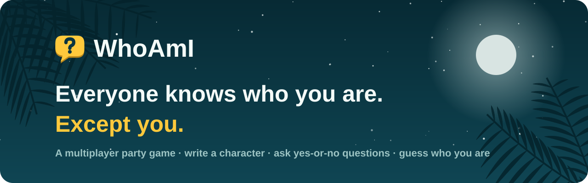
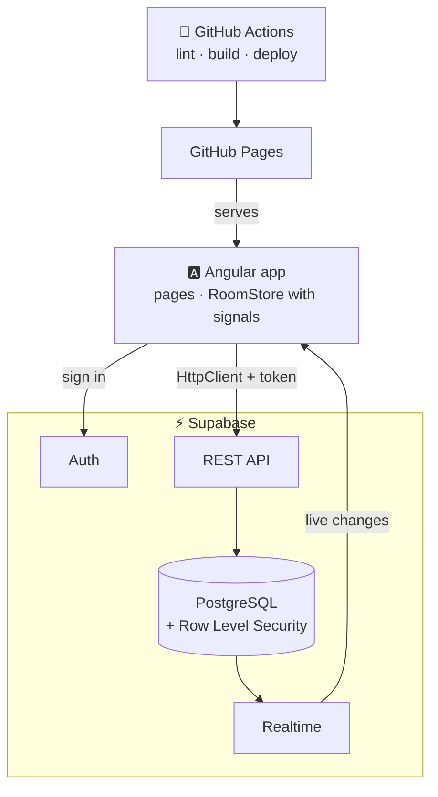

<div align="center">

<a href="https://pauloduarteoliveira.github.io/whoami/">
  <picture>
    <source media="(prefers-color-scheme: dark)" srcset="docs/banner-night.svg">
    <source media="(prefers-color-scheme: light)" srcset="docs/banner-day.svg">
    
  </picture>
</a>

<br>

[](https://github.com/PauloDuarteOliveira/whoami/actions/workflows/deploy.yml)


### [▶&nbsp; Play it now](https://pauloduarteoliveira.github.io/whoami/)

[How to play](#-how-to-play) · [Screenshots](#-screenshots) · [Features](#-features) · [Tech](#-tech-stack) · [Run it yourself](#-run-it-yourself)

</div>

---

## 🎲 How to play

Everyone gets a secret character stuck to their forehead. Everyone can see it, except you.

<table>
  <tr>
    <td align="center" width="33%">
      <h3>✍️ Write</h3>
      Each player writes a character for someone else: a celebrity, a movie hero, a historical figure.
    </td>
    <td align="center" width="33%">
      <h3>❓ Ask</h3>
      On your turn, ask one yes-or-no question. The others vote <b>Yes</b>, <b>No</b> or <b>Unsure</b>.
    </td>
    <td align="center" width="33%">
      <h3>🎯 Guess</h3>
      Think you know? Make a guess. The others judge it. The fewest turns wins.
    </td>
  </tr>
</table>

No accounts, no downloads: create a room, share the 4-letter code, and play from any browser.

## 📸 Screenshots

<p align="center">
  
  <br><sub><b>The game.</b> Players &amp; clues on the left, the question to vote on in the middle, History or Notes on the right.</sub>
</p>

<table>
  <tr>
    <td width="50%"><br><sub><b>Home</b> by night…</sub></td>
    <td width="50%"><br><sub>…and by day.</sub></td>
  </tr>
  <tr>
    <td><br><sub><b>Lobby.</b> Share the code; the Admin names Helpers from the Players rail.</sub></td>
    <td><br><sub><b>Writing.</b> Everyone adds a character to the pool; the rail shows who's done.</sub></td>
  </tr>
  <tr>
    <td><br><sub><b>Guessing.</b> The others judge if the guess is right.</sub></td>
    <td><br><sub><b>Results.</b> Final ranking and the story of every guess.</sub></td>
  </tr>
</table>

<p align="center">
  
  <br><sub><b>The Board.</b> Sketch your theories with a finger, a stylus or the mouse, and share them with the room, live.</sub>
</p>

### 📱 Made for phones too

<p align="center">
  
  &nbsp;
  
  &nbsp;
  
  &nbsp;
  
</p>
<p align="center"><sub>The code first in the lobby, big answer buttons at your thumb, and a tab bar for Play · Clues · Board · History · Notes.</sub></p>

## ✨ Features

<table>
  <tr>
    <td width="33%" valign="top">
      <h4>🏠 Rooms</h4>
      Create a room in seconds, join with a 4-letter code or an invite link. Pick <b>Voice</b> or <b>No-Voice</b> mode, a custom pool or a pre-made deck, timers and when giving up unlocks.
    </td>
    <td width="33%" valign="top">
      <h4>⚡ Live</h4>
      Every vote, question and guess shows up instantly for everyone with Supabase Realtime, with polling as a safety net. Online dots show who's connected.
    </td>
    <td width="33%" valign="top">
      <h4>🧩 Players &amp; clues</h4>
      One card per player with their role, status and answers; open a card to see its clues, filtered by Yes, No or Unsure. Plus the full history of the game.
    </td>
  </tr>
  <tr>
    <td valign="top">
      <h4>📝 Notes &amp; 🎨 Board</h4>
      Write your theories down, or sketch them on your own drawing board. Keep them private, or share them with the room, live.
    </td>
    <td valign="top">
      <h4>🙈 Hide names</h4>
      Playing side by side? Hide the other players' characters so nobody sees them over your shoulder.
    </td>
    <td valign="top">
      <h4>👑 Admin tools</h4>
      The Admin and Helpers can skip a stuck turn, kick players, overrule a guess, add writing time, or start without late players. The Admin names Helpers and can hand over the role.
    </td>
  </tr>
  <tr>
    <td valign="top">
      <h4>🌙 Day &amp; Night</h4>
      Two themes with palm-tree scenery, a moon and twinkling stars, or the sun. The choice is remembered.
    </td>
    <td valign="top">
      <h4>🔐 Accounts</h4>
      Play straight away as a guest. Add an email and password later to keep your name on any device.
    </td>
    <td valign="top">
      <h4>📱 Any screen</h4>
      Desktop, tablet and phone layouts, each designed for how you hold the device.
    </td>
  </tr>
</table>

## 🛠 Tech stack

| | |
|---|---|
| **Front end** | Angular 22: standalone components, signals, Reactive Forms, Router with a guard, HttpClient with an interceptor |
| **Back end** | [Supabase](https://supabase.com): PostgreSQL, REST API (PostgREST), Auth and Realtime |
| **Security** | Row Level Security: every player only reads and changes what they are allowed to |
| **CI / CD** | GitHub Actions: lint and build on every pull request, deploy to GitHub Pages on every merge |
| **Styling** | Plain CSS with CSS variables for the two themes. No UI library. |



<details>
<summary><b>📋 Course requirements: where to find them</b></summary>
<br>

| Requirement | Where |
|---|---|
| 3+ views with RouterLink | Home, Create, Join, Account, Room ([`app.routes.ts`](src/app/app.routes.ts)) |
| Supabase Auth | Anonymous sign-in plus email accounts ([`auth.service.ts`](src/app/core/auth.service.ts), [`account`](src/app/pages/account)) |
| Supabase database | REST calls with HttpClient ([`supabase-api.service.ts`](src/app/core/supabase-api.service.ts)) |
| Environment variables | [`environment.example.ts`](src/environments/environment.example.ts), created in CI by [`set-env.mjs`](scripts/set-env.mjs) from repository secrets |
| Reactive Forms + Validators | Home, Join, Create, Account (`required`, `email`, `minLength`, a custom character validator) |
| `[( )]` two-way binding | Notes ([`notes`](src/app/pages/room/notes)) |
| Native pipes | `date`, `number`, `uppercase` (Lobby, Results, Game) |
| Loading and error states | Join's room lookup, Create, Account, the room page |
| OnInit / OnDestroy | Create, Join, Room and Notes |
| Production build + deploy | [`.github/workflows/deploy.yml`](.github/workflows/deploy.yml) |

</details>

## 🚀 Run it yourself

**You need:** Node.js 24+ and a free [Supabase](https://supabase.com) project.

**1. Get the code**

```bash
git clone https://github.com/PauloDuarteOliveira/whoami.git
cd whoami
npm install
```

**2. Set up Supabase.** In your project's **SQL Editor**, run these files in order:

1. [`supabase/schema.sql`](supabase/schema.sql): the tables
2. [`supabase/seed.sql`](supabase/seed.sql): the pre-made decks
3. [`supabase/migrations/001-players-user-id.sql`](supabase/migrations/001-players-user-id.sql)
4. [`supabase/migrations/002-row-level-security.sql`](supabase/migrations/002-row-level-security.sql)
5. [`supabase/migrations/003-realtime.sql`](supabase/migrations/003-realtime.sql)
6. [`supabase/migrations/004-whiteboards-realtime.sql`](supabase/migrations/004-whiteboards-realtime.sql)
7. [`supabase/migrations/005-troll-reports.sql`](supabase/migrations/005-troll-reports.sql)

Then, under **Authentication → Sign In / Providers**:

- turn **on** *Allow anonymous sign-ins*
- turn **off** *Confirm email*

**3. Add your keys.** Copy `src/environments/environment.example.ts` to `src/environments/environment.ts` and fill in your project URL and publishable key (both are in your Supabase **Project Settings**). This file is git-ignored, so your keys stay on your computer.

**4. Start it**

```bash
npm start
```

Open http://localhost:4200, and open a second tab to play against yourself.

### Deploying

Every pull request runs **lint → build** on GitHub Actions, and every merge into `main` is published to GitHub Pages. The Supabase keys come from the repository secrets `SUPABASE_URL` and `SUPABASE_KEY`.

---

<div align="center">
  <sub>Made for the UPskill JavaScript programme by <a href="https://github.com/PauloDuarteOliveira">Paulo Duarte Oliveira</a> · 2026</sub>
</div>
