<div align="center">

<a href="https://pauloduarteoliveira.github.io/whoami/">
  <picture>
    <source media="(prefers-color-scheme: dark)" srcset="docs/banner-night.png">
    <source media="(prefers-color-scheme: light)" srcset="docs/banner-day.png">
    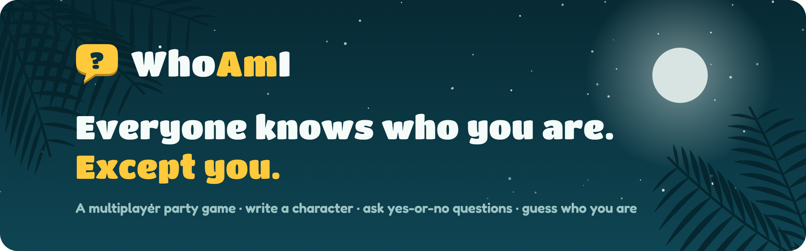
  </picture>
</a>

<br>

[](https://github.com/PauloDuarteOliveira/whoami/actions/workflows/deploy.yml)


### [▶&nbsp; Play it now](https://pauloduarteoliveira.github.io/whoami/)

[How to play](#-how-to-play) · [Screenshots](#-screenshots) · [Features](#-features) · [Tech](#-tech-stack) · [Run it yourself](#-run-it-yourself)

</div>

---

## 🎲 How to play

Everyone gets a secret character stuck to their forehead. Everyone can see it, except you.

<table>
  <tr>
    <td align="center" width="33%">
      <h3>✍️ Write</h3>
      Each player writes a character for someone else, or the room draws them from a pre-made deck or your own list.
    </td>
    <td align="center" width="33%">
      <h3>❓ Ask</h3>
      On your turn, ask one yes-or-no question. The others answer <b>Yes</b>, <b>No</b> or <b>Unsure</b>.
    </td>
    <td align="center" width="33%">
      <h3>🎯 Guess</h3>
      Think you know? Make a guess. The others judge it. The fewest questions wins.
    </td>
  </tr>
</table>

No downloads, and no account needed: create a room, share the 4-letter code, the invite link or the QR code, and play from any browser.

**Two ways to play**

- **No-Voice:** questions and guesses are typed, and everyone answers with buttons. Every answer is kept as a clue.
- **Voice:** you're together or on a call. Questions and answers are spoken; the asker taps **Guess** after saying it out loud, or **Next turn**. The app keeps the turns, the timer and the guess votes.

<details>
<summary><b>How votes are decided</b></summary>
<br>

| Votes | Answer |
|---|---|
| More people are Unsure than voted Yes or No | **Unsure** |
| Otherwise, more Yes than No (or more No than Yes) | **Yes** (or **No**) |
| As many Yes as No | **Unsure** |

So Yes + Unsure gives **Yes** (someone knew), but 5 Unsure + 1 Yes gives **Unsure** (most people didn't). A guess is **Correct** only with more Correct than Wrong votes; a tie counts as Wrong.

**With a turn timer**, the asker's own time (yellow) covers asking and guessing, and pauses while the others vote. Voting and judging a guess get 30 seconds each (blue); when they run out, the votes in so far decide. The Admin and Helpers can close a stuck vote at any time.

</details>

## 📸 Screenshots

<p align="center">
  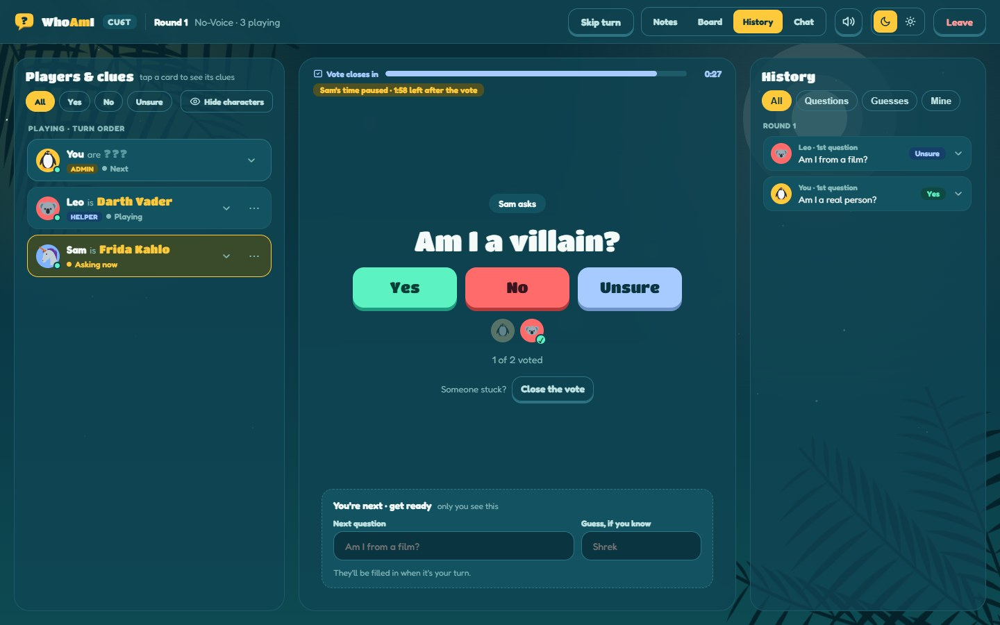
  <br><sub><b>The game.</b> Players &amp; clues on the left, the question to vote on in the middle, Notes, History or Chat on the right.</sub>
</p>

<table>
  <tr>
    <td width="50%">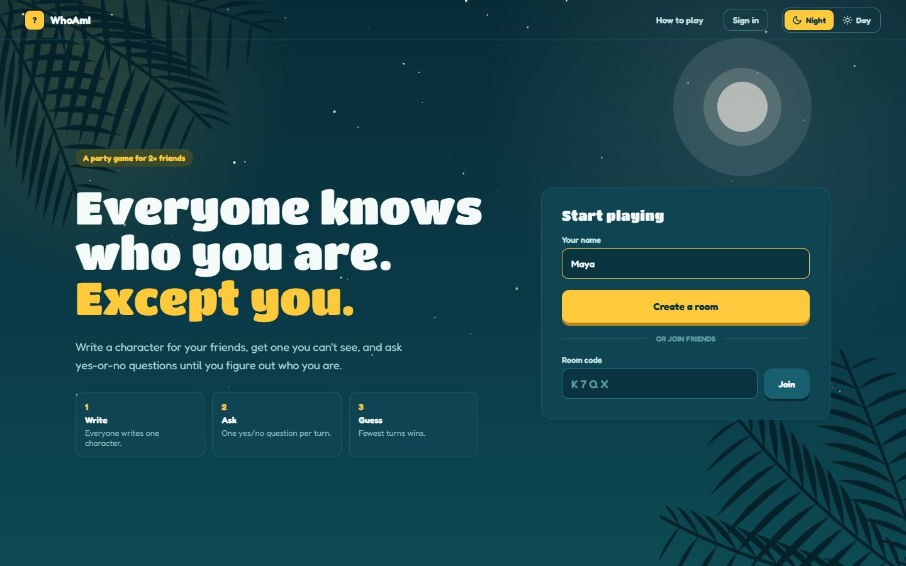<br><sub><b>Home</b> by night…</sub></td>
    <td width="50%">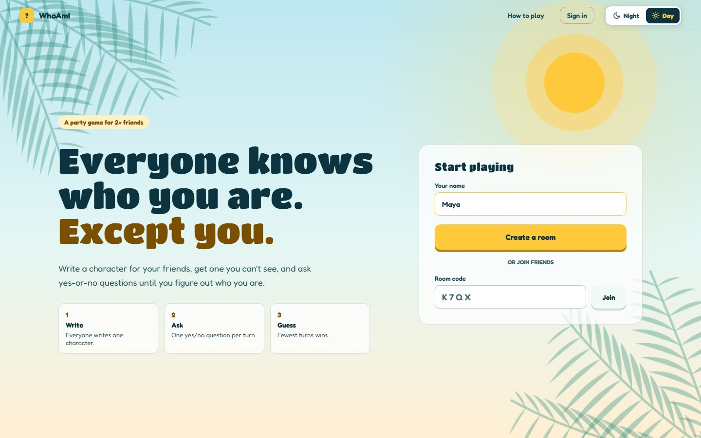<br><sub>…and by day.</sub></td>
  </tr>
  <tr>
    <td>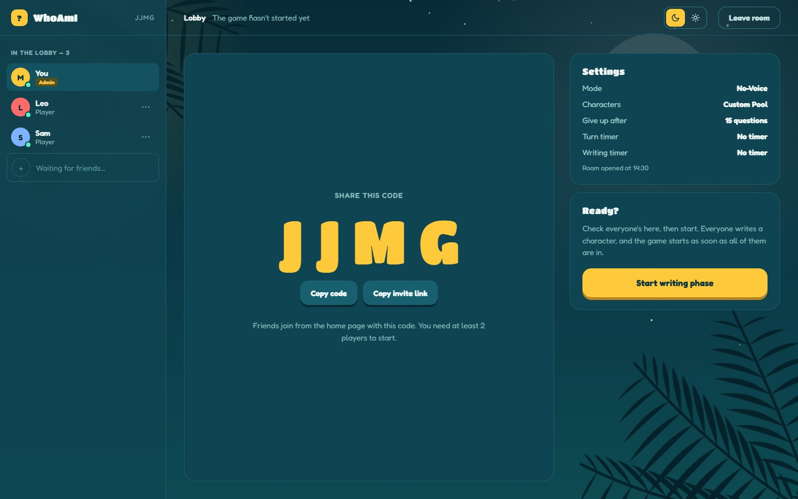<br><sub><b>Lobby.</b> Share the code, the link or the QR code; the Admin names Helpers.</sub></td>
    <td>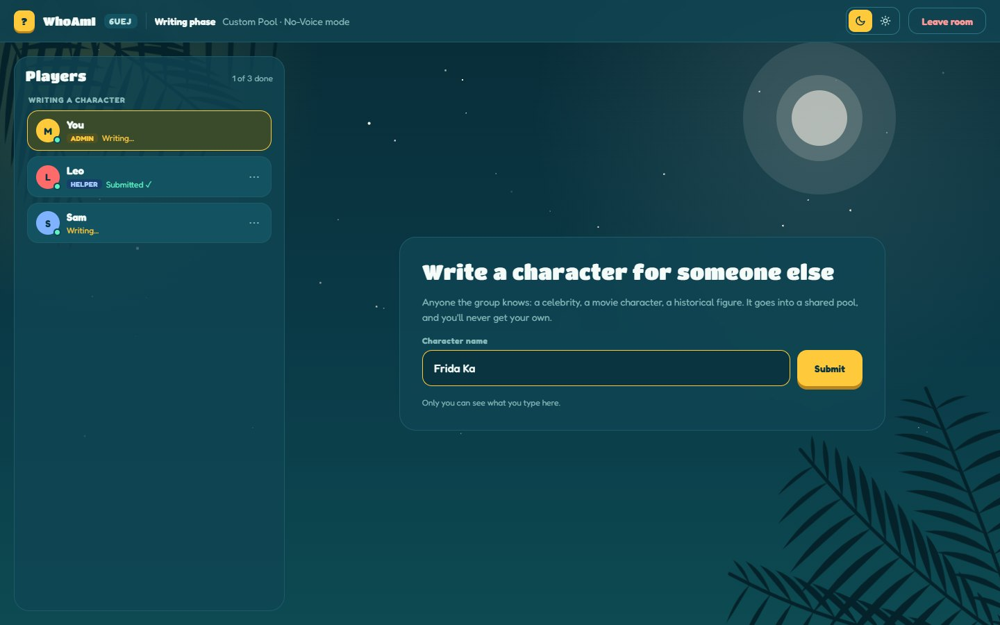<br><sub><b>Writing.</b> Everyone adds a character to the pool; the rail shows who's done.</sub></td>
  </tr>
  <tr>
    <td>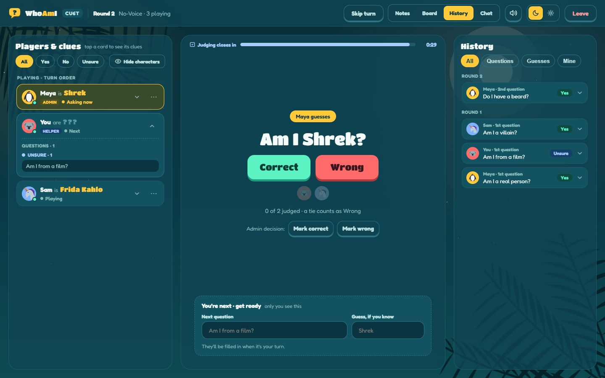<br><sub><b>Guessing.</b> The others judge if the guess is right.</sub></td>
    <td>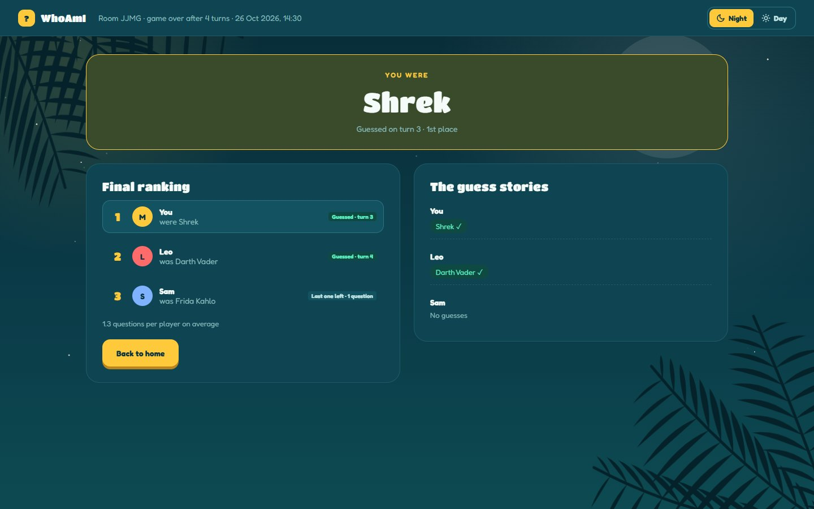<br><sub><b>Results.</b> Final ranking and the story of every guess, then Back to lobby.</sub></td>
  </tr>
</table>

<p align="center">
  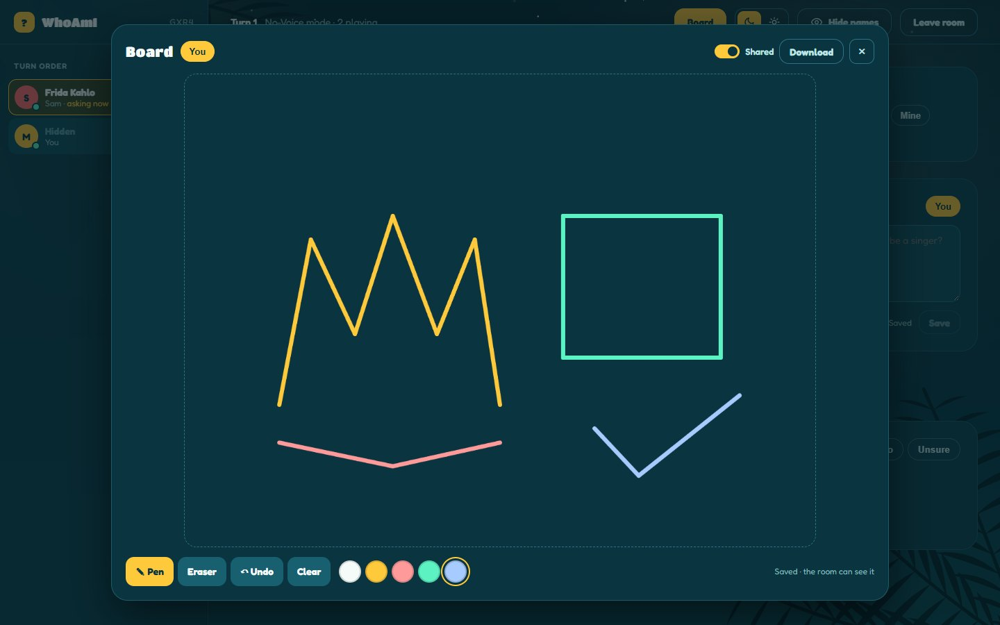
  <br><sub><b>The Board.</b> Sketch your theories with a finger, a stylus or the mouse, and share them with the room, live.</sub>
</p>

### 📱 Made for phones too

<p align="center">
  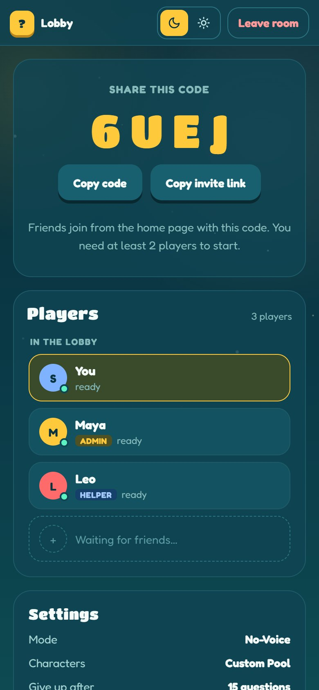
  &nbsp;
  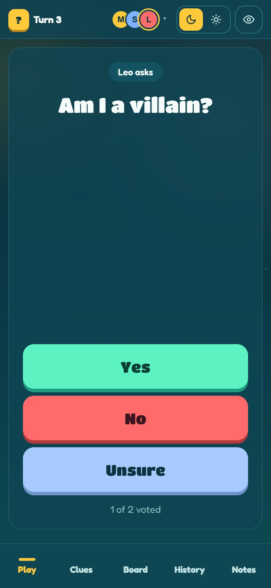
  &nbsp;
  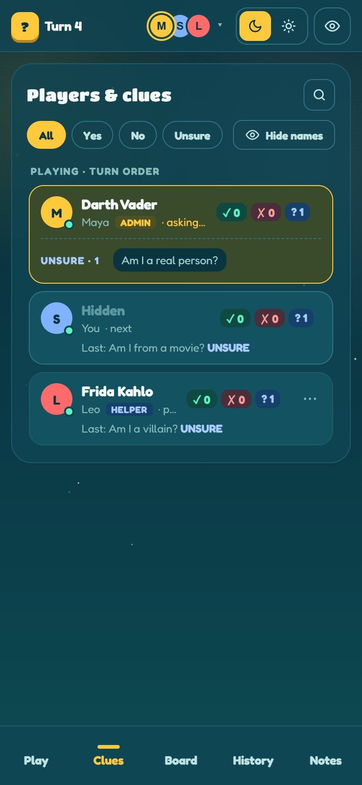
  &nbsp;
  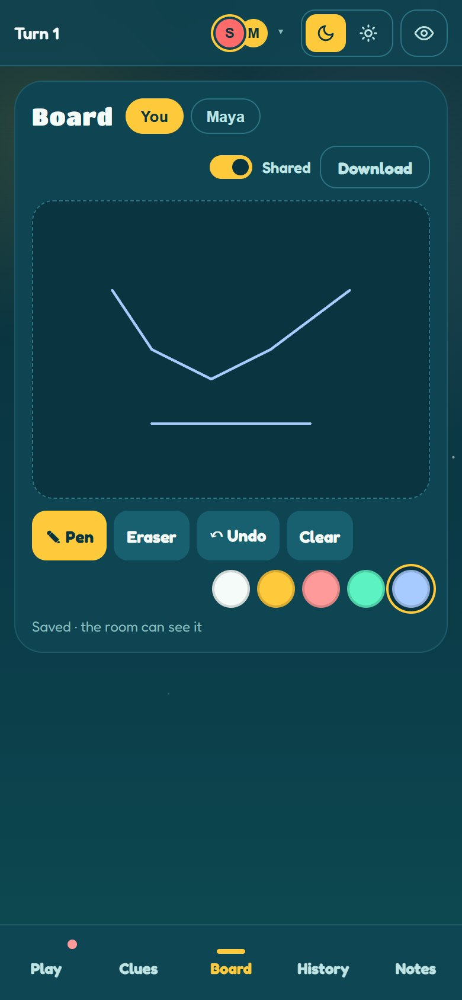
</p>
<p align="center"><sub>The code first in the lobby (with a full-screen QR code), big answer buttons at your thumb, and a tab bar for Play · Clues · Board · History · Notes · Chat.</sub></p>

## ✨ Features

<table>
  <tr>
    <td width="33%" valign="top">
      <h4>🏠 Rooms</h4>
      Create a room in seconds and invite with a 4-letter code, a link or a QR code. Pick <b>Voice</b> or <b>No-Voice</b>, a Custom Pool, a pre-made deck or one of your lists, the timers and when giving up unlocks.
    </td>
    <td width="33%" valign="top">
      <h4>⚡ Live</h4>
      Every vote, question and guess shows up instantly for everyone with Supabase Realtime, with polling as a safety net. Online dots and faces show who's connected and who has voted.
    </td>
    <td width="33%" valign="top">
      <h4>🧩 Players &amp; clues</h4>
      One card per player: "Leo is Cleopatra", role and status. Open a card for its clues, grouped by Yes, No and Unsure, then its guesses. History lists every round, with who voted what.
    </td>
  </tr>
  <tr>
    <td valign="top">
      <h4>⏱️ Turn timer</h4>
      Your time to ask and guess, 30 seconds for each vote, and the turn passes on by itself. While others play, write your next question and guess so they're ready when your turn comes.
    </td>
    <td valign="top">
      <h4>🔔 Sound</h4>
      Short cues for "vote now", "your turn", the last 10 seconds and a right guess, plus a vibration on phones. One tap mutes them, remembered on that device.
    </td>
    <td valign="top">
      <h4>🔁 Play again</h4>
      After the results, go back to the lobby of the same room: last game's cards and history stay, new friends can join, and the Admin picks the next settings and presses Play again.
    </td>
  </tr>
  <tr>
    <td valign="top">
      <h4>📝 Notes, 🎨 Board &amp; 💬 Chat</h4>
      Write your theories down or sketch them on your own board, private or shared with the room, live. A room chat runs from the lobby to the end.
    </td>
    <td valign="top">
      <h4>👑 Admin tools</h4>
      The Admin and Helpers can skip a turn, close a stuck vote, overrule a guess, kick or mute players, and deal with troll characters (the room votes to replace them). The Admin can hand over the role.
    </td>
    <td valign="top">
      <h4>👀 Spectators</h4>
      Friends who arrive mid-game watch, chat and see every character, then play the next game. Hide characters when you're playing side by side.
    </td>
  </tr>
  <tr>
    <td valign="top">
      <h4>🔐 Accounts</h4>
      Play straight away as a guest, or sign in with Google, Discord or an email. Your name, animal, Day / Night and room settings follow you to any device. You can delete your account.
    </td>
    <td valign="top">
      <h4>🏅 History &amp; badges</h4>
      Signed-in players get Your account: stats, every game played with who was who, 26 badges to unlock, and their own character lists to host with.
    </td>
    <td valign="top">
      <h4>🌙 Day &amp; Night · 📱 Any screen</h4>
      Two themes with palm-tree scenery that follow your device until you choose. Desktop, tablet and phone layouts, each designed for how you hold the device.
    </td>
  </tr>
</table>

## 🛠 Tech stack

| | |
|---|---|
| **Front end** | Angular 22: standalone components, signals, Reactive Forms, Router with a guard, HttpClient with an interceptor |
| **Back end** | [Supabase](https://supabase.com): PostgreSQL, REST API (PostgREST), Auth (anonymous, email, Google, Discord) and Realtime |
| **Security** | Row Level Security: every player only reads and changes what they are allowed to |
| **CI / CD** | GitHub Actions: lint and build on every pull request, deploy to GitHub Pages on every merge |
| **Styling** | Plain CSS with CSS variables for the two themes. No UI library. |
| **Extras** | QR codes with [`qrcode`](https://www.npmjs.com/package/qrcode), sounds made in the browser with the Web Audio API (no audio files), animal avatars from [Twemoji](https://github.com/jdecked/twemoji) (CC BY 4.0) |

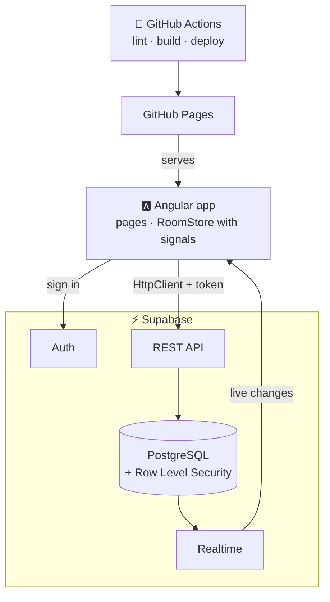

<details>
<summary><b>📋 Course requirements: where to find them</b></summary>
<br>

| Requirement | Where |
|---|---|
| 3+ views with RouterLink | Home, Create, Join, Your account, Room ([`app.routes.ts`](src/app/app.routes.ts)) |
| Supabase Auth | Anonymous sign-in, email accounts, Google and Discord ([`auth.service.ts`](src/app/core/auth.service.ts), [`account`](src/app/pages/account)) |
| Supabase database | REST calls with HttpClient ([`supabase-api.service.ts`](src/app/core/supabase-api.service.ts)) |
| Environment variables | [`environment.example.ts`](src/environments/environment.example.ts), created in CI by [`set-env.mjs`](scripts/set-env.mjs) from repository secrets |
| Reactive Forms + Validators | Home, Join, Create, Your account (`required`, `email`, `minLength`, a custom name validator) |
| `[( )]` two-way binding | Notes ([`notes`](src/app/pages/room/notes)) |
| Native pipes | `date`, `number`, `uppercase` (Lobby, Game, Results, Notes, Chat) |
| Loading and error states | Join's room lookup, Create, Your account, the room page |
| OnInit / OnDestroy | OnInit: Create, Join, Room, Notes, Your account, Next game · OnDestroy: Room and Board |
| Production build + deploy | [`.github/workflows/deploy.yml`](.github/workflows/deploy.yml) |

</details>

## 🚀 Run it yourself

**You need:** Node.js 24+ and a free [Supabase](https://supabase.com) project.

**1. Get the code**

```bash
git clone https://github.com/PauloDuarteOliveira/whoami.git
cd whoami
npm install
```

**2. Set up Supabase.** In your project's **SQL Editor**, run these files in order:

1. [`supabase/schema.sql`](supabase/schema.sql): the tables
2. [`supabase/seed.sql`](supabase/seed.sql): the pre-made decks
3. [`001-players-user-id.sql`](supabase/migrations/001-players-user-id.sql): each player belongs to a signed-in user
4. [`002-row-level-security.sql`](supabase/migrations/002-row-level-security.sql): who can read and change what
5. [`003-realtime.sql`](supabase/migrations/003-realtime.sql): live updates
6. [`004-whiteboards-realtime.sql`](supabase/migrations/004-whiteboards-realtime.sql): live drawing Boards
7. [`005-troll-reports.sql`](supabase/migrations/005-troll-reports.sql): reporting troll characters
8. [`006-room-chat.sql`](supabase/migrations/006-room-chat.sql): the chat and the animal avatars
9. [`007-game-history.sql`](supabase/migrations/007-game-history.sql): your game history
10. [`008-delete-account.sql`](supabase/migrations/008-delete-account.sql): delete your account
11. [`009-character-lists.sql`](supabase/migrations/009-character-lists.sql): your own character lists
12. [`010-play-again.sql`](supabase/migrations/010-play-again.sql): Play again in the same room

Then, under **Authentication → Sign In / Providers**:

- turn **on** *Allow anonymous sign-ins*
- turn **off** *Confirm email*
- *(optional)* turn on **Google** and **Discord** with each provider's Client ID and secret. In Google Cloud and the Discord Developer Portal, the redirect URL is `https://<your-project>.supabase.co/auth/v1/callback`.

Under **Authentication → URL Configuration**, set the **Site URL** to where the app runs and add it (plus `http://localhost:4200/**`) to the **Redirect URLs**, so Google and Discord come back to the app.

**3. Add your keys.** Copy `src/environments/environment.example.ts` to `src/environments/environment.ts` and fill in your project URL and publishable key (both are in your Supabase **Project Settings**). This file is git-ignored, so your keys stay on your computer.

**4. Start it**

```bash
npm start
```

Open http://localhost:4200, and open a second tab to play against yourself.

### Deploying

Every pull request runs **lint → build** on GitHub Actions, and every merge into `main` is published to GitHub Pages. The Supabase keys come from the repository secrets `SUPABASE_URL` and `SUPABASE_KEY`.

---

<div align="center">
  <sub>Made for the UPskill JavaScript programme by <a href="https://github.com/PauloDuarteOliveira">Paulo Duarte Oliveira</a> · 2026</sub>
</div>
